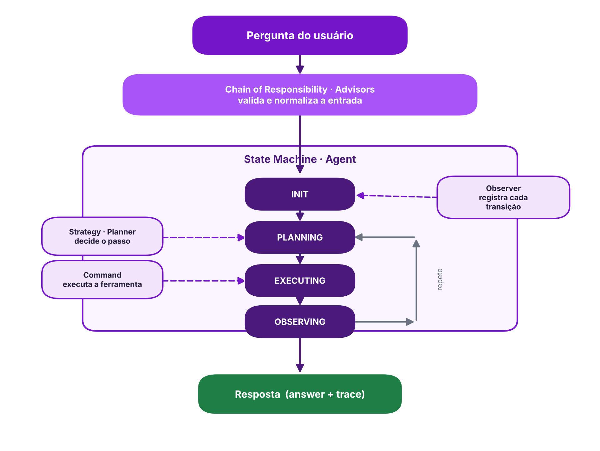
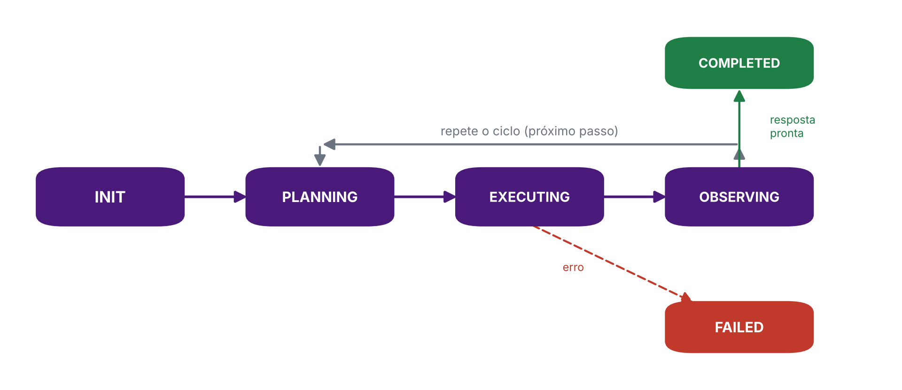

<!-- Banner -->
<p align="center">
  
</p>

<p align="center">
  
  
  
  
  
  
  
</p>

<h1 align="center">SophIA — Assistente de Recomendação de Livros</h1>

<p align="center">
  Um <b>agente de IA</b> que entende um pedido em linguagem natural e recomenda livros de um catálogo próprio,<br>
  combinando <b>busca semântica</b> (por significado) com <b>filtros estruturados</b> — com a IA rodando <b>localmente</b>.
</p>

---

## 📑 Sumário

- [Sobre o projeto](#-sobre-o-projeto)
- [Demonstração](#-demonstração)
- [Guia de tecnologias utilizadas](#-guia-de-tecnologias-utilizadas)
- [Como funciona (arquitetura)](#-como-funciona-arquitetura)
- [Fluxo de uma requisição](#-fluxo-de-uma-requisição-passo-a-passo)
- [Design Patterns em detalhe](#-design-patterns-em-detalhe)
- [Como executar](#-como-executar)
- [Estrutura de pastas](#-estrutura-de-pastas)
- [Equipe e contribuições](#-equipe-e-contribuições)

---

## 💡 Sobre o projeto

A **SophIA** recebe um pedido em linguagem natural — *"quero um romance brasileiro clássico sobre ciúme"* — entende a intenção e **recomenda livros de um catálogo próprio**. Para isso ela combina duas formas de busca:

- **Busca semântica (vetorial):** a pergunta vira um *embedding* (vetor numérico que representa o significado) e é comparada com os embeddings dos livros, encontrando os mais parecidos em sentido.
- **Filtros estruturados:** critérios objetivos como gênero, autor, ano e nota mínima, casados com os valores reais do catálogo.

Toda a inteligência roda **localmente** via **Ollama** — nenhum dado é enviado para serviços externos. Mas o diferencial do projeto não é só *o que* ele faz, e sim *como* é construído: uma **arquitetura de agente** apoiada em **7 design patterns**, onde cada padrão resolve uma parte do problema de forma isolada, testável e substituível.

---

## 🎬 Demonstração

<p align="center">
  
</p>

> No topo há um seletor de **Estratégia** que troca, em tempo real, o "jeito de pensar" do agente (demonstração ao vivo do padrão *Strategy*).

---

## 🛠️ Guia de tecnologias utilizadas

Cada tecnologia foi escolhida por um motivo específico dentro do projeto.

| Tecnologia | O que é | Por que foi usada aqui |
|-----------|---------|------------------------|
| **Java 21** | Linguagem principal do backend | Recursos modernos (records, text blocks, enums ricos) deixam o código do agente limpo e seguro |
| **Spring Boot 4.1** | Framework de aplicação | Fornece a **Injeção de Dependência**, o servidor web (REST) e a configuração externa (`application.properties`) |
| **Spring AI 2.0** | Camada de abstração de IA | Dá o `ChatClient` (conversa com o modelo) e o `EmbeddingModel` (gera vetores) já integrados ao Ollama |
| **Ollama** | Executor de modelos de IA locais | Roda os modelos na própria máquina, sem nuvem: `gemma4:e2b` (chat) e `nomic-embed-text` (embeddings de 768 dimensões) |
| **PostgreSQL 17** | Banco de dados relacional | Guarda os livros, autores e gêneros |
| **pgvector** | Extensão de vetores do Postgres | Permite guardar os embeddings (`vector(768)`), medir **distância de cosseno** (`<=>`) e indexar com **HNSW** para busca rápida |
| **JavaFX 21** | Interface gráfica de desktop | Tela de chat construída no **Scene Builder**, consumindo a API REST |
| **Docker + Docker Compose** | Containers e orquestração | Sobe aplicação + banco + Ollama juntos, conectados, com um comando |
| **Apache Maven** | Build e dependências | Gerencia bibliotecas e empacota a aplicação |
| **Apache Commons CSV** | Leitura de CSV | Importa o catálogo de livros (`books.csv`) para o banco |

---

## 🧠 Como funciona (arquitetura)

A SophIA não responde de uma vez: ela trabalha como um **agente**, em um ciclo de **planejar → executar → observar**, repetindo até ter a resposta. Uma máquina de estados coordena esse ciclo, e os outros padrões se encaixam em volta dela.

<p align="center">
  
</p>

O ciclo da máquina de estados, em detalhe:

<p align="center">
  
</p>

---

## 🔄 Fluxo de uma requisição (passo a passo)

1. A pergunta chega pela API e passa pela **corrente de advisors** (validação e normalização).
2. O agente entra no estado **INIT** e vai para **PLANNING**.
3. Em **PLANNING**, o **planner** (estratégia escolhida) decide o próximo passo.
4. Em **EXECUTING**, o **comando** correspondente roda (extrair filtros, gerar embedding, buscar ou responder).
5. Em **OBSERVING**, o agente avalia o resultado e decide: repetir o ciclo, encerrar ou tratar erro.
6. Ao chegar em **COMPLETED**, a resposta volta pela corrente (pós-processamento) e é devolvida.
7. Durante todo o caminho, os **observers** registram cada transição.

Na prática, o fluxo de recomendação é: **extrair filtros → gerar o embedding da pergunta → buscar no catálogo → escrever a recomendação**.

---

## 🧩 Design Patterns em detalhe

O projeto usa **7 padrões de projeto**. Para cada um: o que é, por que foi aplicado neste projeto, como foi aplicado e o que ele faz no projeto.

| # | Padrão | Categoria | Pacote | Responsável |
|---|--------|-----------|--------|-------------|
| 1 | **State Machine** | Comportamental | `agent` + `agent.state` | **Leonardo** |
| 2 | **Command** | Comportamental | `agent.command` | **Maria Eduarda** |
| 3 | **Strategy** | Comportamental | `agent.planner` | **Natanael** |
| 4 | **Composite** | Estrutural | `agent.command` + `agent.planner` | **Natanael** |
| 5 | **Chain of Responsibility** | Comportamental | `agent.advisor` | **Jhonatan** |
| 6 | **Observer** | Comportamental | `agent.observer` | **Jhonatan** |
| 7 | **Dependency Injection** | Criacional (Spring) | projeto todo | **Jhonatan** |

<br>

### 1. State Machine &nbsp;·&nbsp;

- **O que é:** padrão comportamental em que um objeto muda de comportamento conforme seu estado interno. Cada estado é uma classe que sabe processar o contexto e dizer qual é o próximo estado.
- **Por que foi aplicado:** um agente executa um fluxo de várias etapas que pode ramificar (achou / não achou resultado) e repetir. Modelar isso como uma máquina de estados torna o fluxo **explícito e controlado**, em vez de um método gigante cheio de `if`.
- **Como foi aplicado:** o enum `AgentState` (`INIT, PLANNING, EXECUTING, OBSERVING, COMPLETED, FAILED`), a classe `Agent` (que roda o laço), a interface `StateHandler` e um handler por estado (`InitStateHandler`, `PlanningStateHandler`, `ExecutingStateHandler`, `ObservingStateHandler`). Cada handler recebe o `AgentContext`, faz seu trabalho e retorna o próximo `AgentState`; o laço roda até um estado terminal.
- **O que faz no projeto:** é a **espinha dorsal** do agente — coordena *quando* cada etapa acontece, do início da requisição até a resposta final.

### 2. Command &nbsp;·&nbsp; 

- **O que é:** encapsula uma ação como um objeto com uma interface comum, para ser executada sem que o chamador saiba o que ela faz por dentro.
- **Por que foi aplicado:** o agente tem várias "ferramentas". Tratá-las como comandos uniformes deixa o executor simples e permite montar um **plano** como uma lista de passos.
- **Como foi aplicado:** a interface `Command` (`name()` + `execute(ctx)`), o `CommandRegistry` (que indexa todos os comandos pelo nome, recebendo a lista pronta por injeção de dependência) e os comandos concretos. O `ExecutingStateHandler` apenas pega o nome do próximo passo e chama `commandRegistry.get(nome).execute(ctx)`.
- **O que faz no projeto:** são as ações concretas: `extract_filters`, `embed_query`, `search_books` e `generate_answer`.

### 3. Strategy &nbsp;·&nbsp; 

- **O que é:** uma família de algoritmos intercambiáveis por trás de uma interface comum.
- **Por que foi aplicado:** existem vários jeitos de o agente **raciocinar** sobre os passos. O Strategy permite trocar a estratégia sem tocar na máquina de estados — inclusive **em tempo real**, pelo seletor do front.
- **Como foi aplicado:** a interface `Planner` (`plan(ctx)`), o `PlannerRegistry` e as estratégias concretas. O `PlanningStateHandler` resolve qual planner usar (por requisição) e pede a ele o próximo passo.
- **O que faz no projeto:** oferece 3 modos de decisão — `PlanThenExecute` (planeja tudo de uma vez), `ReAct` (decide um passo por vez) e `HumanInTheLoop` (pede mais detalhes quando a pergunta é vaga).

### 4. Composite &nbsp;·&nbsp; 

- **O que é:** padrão estrutural que monta objetos em árvore e trata o grupo (composto) igual a um item único (folha), pela mesma interface.
- **Por que foi aplicado:** a etapa de recuperação é, na verdade, três comandos em sequência. Agrupá-los em um único comando mantém o executor simples e demonstra o "todo tratado como parte".
- **Como foi aplicado:** `CompositeCommand` implementa `Command` e contém uma `List<Command>` (os filhos); seu `execute()` roda cada filho. O `CompositePlanner` usa esse comando composto, chamado `retrieve`.
- **O que faz no projeto:** o comando `retrieve` agrupa *extrair filtros + gerar embedding + buscar* e é executado como se fosse um comando só — quem chama `execute()` não sabe que, por dentro, são três.

### 5. Chain of Responsibility &nbsp;·&nbsp; 

- **O que é:** uma corrente de objetos processa a requisição; cada elo trata e passa adiante, ou interrompe a corrente.
- **Por que foi aplicado:** preocupações como validar a entrada e ajustar a saída não deveriam poluir o núcleo do agente. A corrente as isola em "camadas" em volta dele.
- **Como foi aplicado:** a interface `Advisor`, a `AdvisorChain` (percorre os elos; quando acabam, executa o próprio agente) e os advisors concretos.
- **O que faz no projeto:** o `InputGuardAdvisor` valida e normaliza a pergunta antes do agente (e **interrompe** se for inválida); o `ResponsePolishAdvisor` ajusta a resposta depois que o agente termina.

### 6. Observer &nbsp;·&nbsp; 

- **O que é:** observadores se inscrevem em um sujeito e são notificados quando algo acontece, sem acoplamento.
- **Por que foi aplicado:** monitorar o agente (logs, métricas) não deveria estar misturado à sua lógica. O Observer separa isso e permite adicionar monitoramento novo sem mexer no núcleo.
- **Como foi aplicado:** a interface `AgentObserver` (`onTransition(from, to, ctx)`); o `Agent` é o **sujeito** e notifica todos os observers a cada transição de estado.
- **O que faz no projeto:** o `LoggingObserver` registra cada transição e comando executado; o `MetricsObserver` coleta métricas (execuções, transições, falhas).

### 7. Dependency Injection &nbsp;·&nbsp;

- **O que é:** o framework cria os objetos (beans) e os entrega prontos, em vez de cada classe instanciar suas dependências com `new`.
- **Por que foi aplicado:** mantém tudo **desacoplado** e **extensível**; o truque-chave é injetar uma **lista** de beans, o que faz o sistema se montar sozinho.
- **Como foi aplicado:** injeção por construtor em todo o projeto. O `Agent` recebe `List<StateHandler>` e `List<AgentObserver>`; o `CommandRegistry` recebe `List<Command>`; o `PlannerRegistry` recebe `List<Planner>`.
- **O que faz no projeto:** conecta todo o grafo de objetos. Adicionar um comando, planner, advisor, observer ou estado é só criar uma classe `@Component` — ela entra na lista certa automaticamente, sem registro manual.

---

## 🚀 Como executar

> Pré-requisitos: **Docker** e ~5 GB livres (os modelos são baixados no primeiro uso).

**1. Subir backend + banco + IA:**
```bash
cd backend
docker compose up --build
```
Na primeira vez: cria o banco, roda o schema, sobe o Ollama, constrói a aplicação, baixa os modelos e **popula o catálogo sozinho** (auto-seed).

**2. Testar a API:**
```bash
curl "http://localhost:8080/api/chat?message=quero um romance clássico sobre ciúme"
```

**3. Abrir o chat (front):**
```bash
cd frontend
mvn javafx:run
```

| Método | Rota | Descrição |
|--------|------|-----------|
| `POST` | `/api/chat` | Corpo JSON `{question, planner}` |
| `GET`  | `/api/chat?message=...&planner=...` | Atalho para testes |
| `POST` | `/admin/import-csv` | Importa o catálogo |
| `POST` | `/admin/reindex` | Gera os embeddings |

---

## 📂 Estrutura de pastas

```
SophIA/
├── backend/                    # API + agente (Spring Boot)
│   ├── src/main/java/br/com/fatec/sophia/
│   │   ├── agent/              # o AGENTE
│   │   │   ├── state/          # State Machine
│   │   │   ├── command/        # Command + Composite
│   │   │   ├── planner/        # Strategy + Composite
│   │   │   ├── advisor/        # Chain of Responsibility
│   │   │   └── observer/       # Observer
│   │   ├── web/                # controllers REST + DTOs
│   │   ├── ingest/             # importação do CSV + embeddings
│   │   ├── model/ repository/  # entidades e acesso ao banco
│   │   └── config/ common/     # ChatClient, propriedades, utilitários
│   ├── init-db/01-init.sql     # schema (pgvector)
│   └── compose.yaml
└── frontend/                   # Chat desktop (JavaFX)
```

---

## 👥 Equipe e contribuições

| Integrante | Responsabilidade |
|------------|------------------|
| **Leonardo** | Padrão **State Machine** + **integração da LLM** (Spring AI + Ollama) + **ingestão de dados** (CSV) |
| **Maria Eduarda** | Padrão **Command** + **Frontend** (JavaFX) |
| **Natanael** | Padrões **Strategy** e **Composite** |
| **Guilherme Valim** | **Banco de dados** (PostgreSQL + pgvector) e **Embeddings** |
| **Jhonatan** | Padrões **Chain of Responsibility**, **Observer** e **Injeção de Dependência** + **integração e ajustes finais** |

### Leonardo — State Machine, LLM e ingestão
Fez o *setup* e a ligação da **LLM** com o banco vetorial no backend: configurou o modelo de chat e o de embeddings no **Ollama** via Spring AI, cuidou da **ingestão de dados** (importar o CSV de livros e reindexar via endpoints POST) e implementou o padrão **State** — a modularização do fluxo em estados encadeados (extração de filtros → embedding → busca → retorno/erro), que é a base da máquina de estados do agente.

### Maria Eduarda — Command e Frontend
Responsável pelo padrão **Command** (a interface, o registry e as ferramentas do agente), que encapsula cada ação de forma uniforme. Também desenvolveu todo o **frontend** em JavaFX (Scene Builder): a tela de chat, o tema visual e a ligação assíncrona com a API REST do backend.

### Natanael — Strategy e Composite
Responsável por duas camadas de orquestração. O padrão **Strategy** (os *planners*), que define como o agente decide os passos — incluindo as estratégias ReAct, Plan-then-Execute e Human-in-the-Loop. E o padrão **Composite** (o comando composto `retrieve`), que agrupa a etapa de recuperação em um único comando tratado como qualquer outro.

### Guilherme Valim — Banco de dados e Embeddings
Responsável pela fundação de dados: o schema escrito à mão (`01-init.sql`) com as tabelas e a coluna vetorial (`vector(768)`), a extensão **pgvector**, o índice **HNSW** e a consulta de **busca híbrida** que ordena por distância de cosseno. Cuidou também do armazenamento e da indexação dos **embeddings** dos livros.

### Jhonatan — Chain of Responsibility, Observer, DI e integração
Responsável pela camada de advisors (**Chain of Responsibility**) que envolve o agente, pelo **Observer** (logging e métricas) e por garantir a **Injeção de Dependência** que conecta todas as peças. Além dos padrões, cuidou de **tudo o que faltava para o projeto funcionar de ponta a ponta**: a confiabilidade da busca por gênero/autor (extração de filtros casada com o catálogo real + *fallback* semântico), os ajustes de performance, o *auto-seed* do catálogo e a depuração que deixou o sistema rodando redondo.

---

<p align="center"><sub>Projeto acadêmico · Fatec · Arquitetura de agente de IA com design patterns</sub></p>
